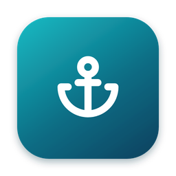
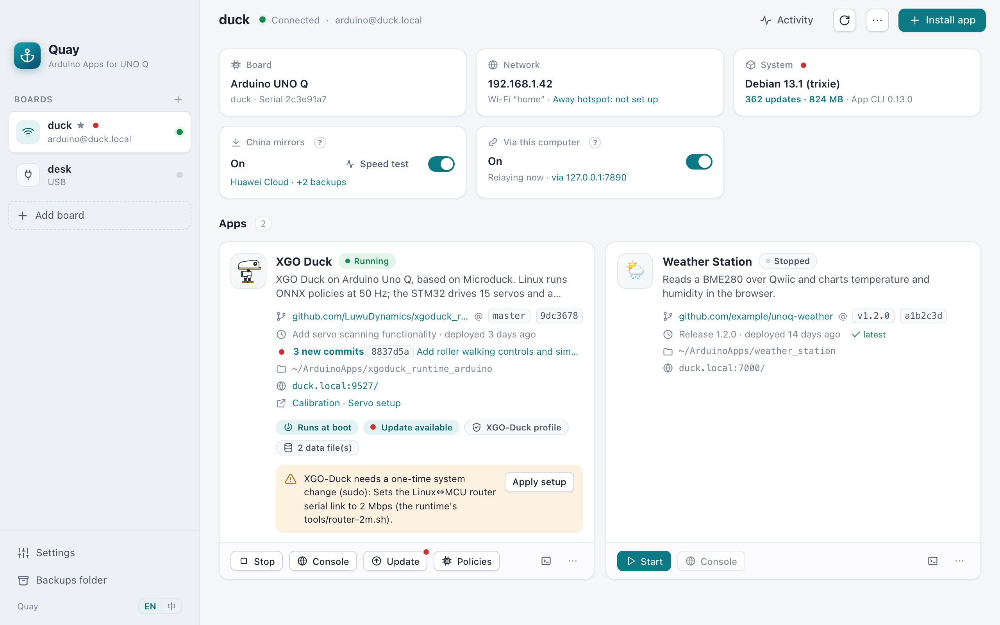
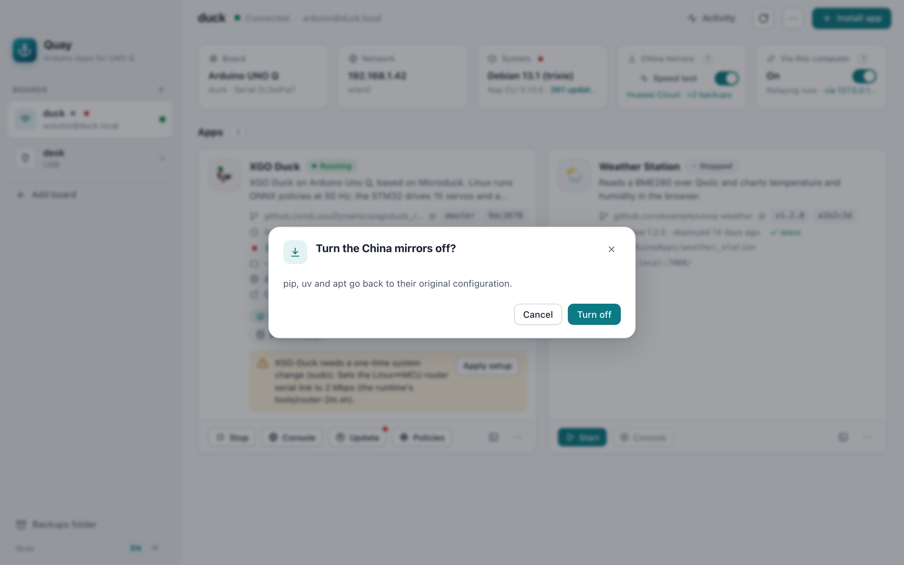
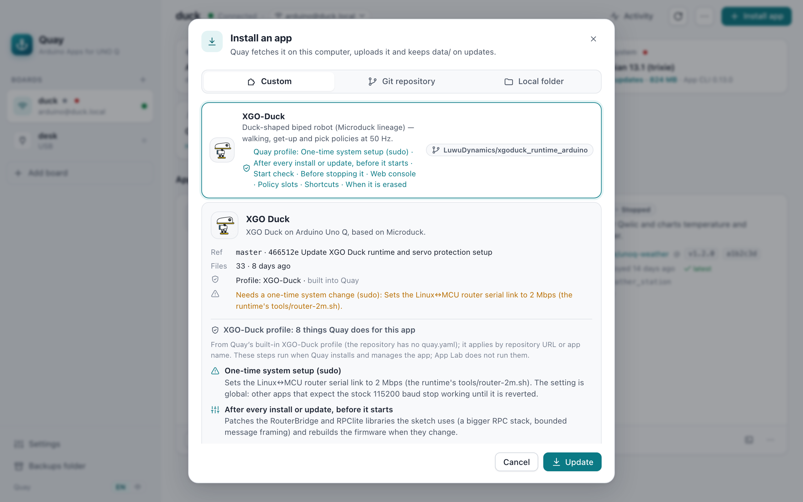
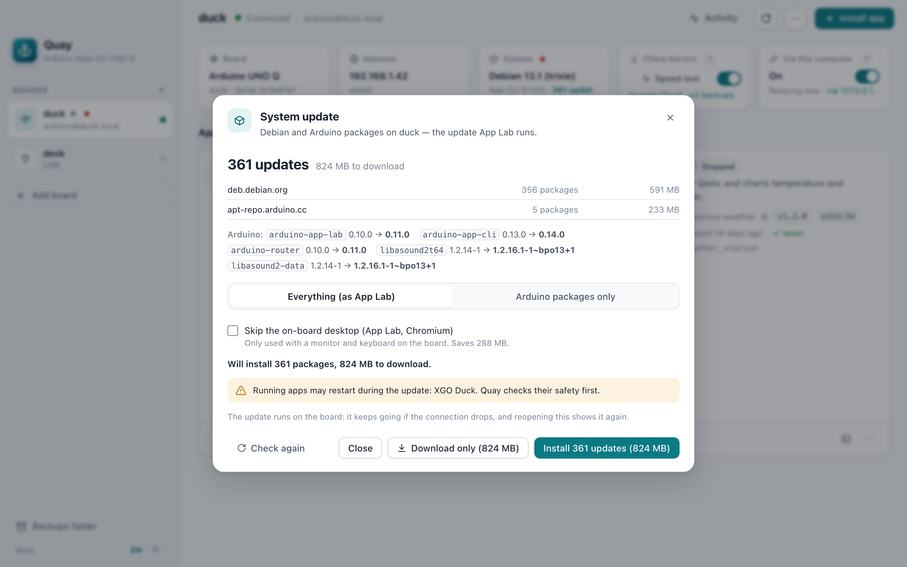
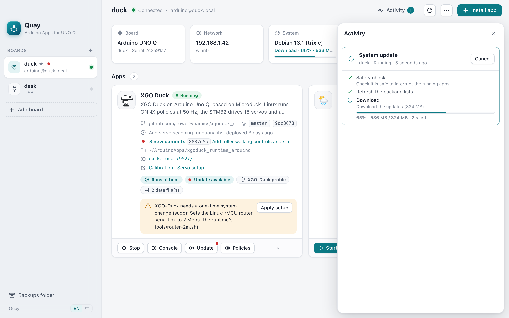
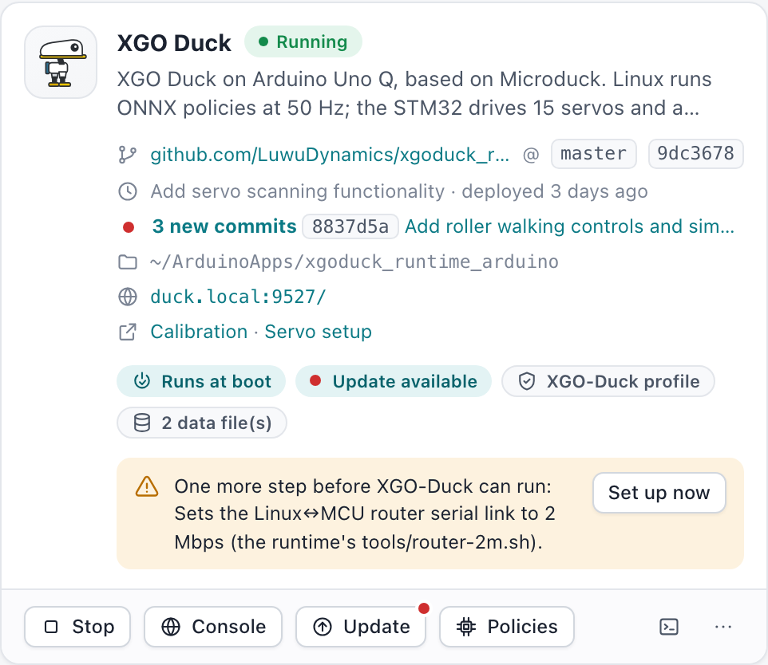
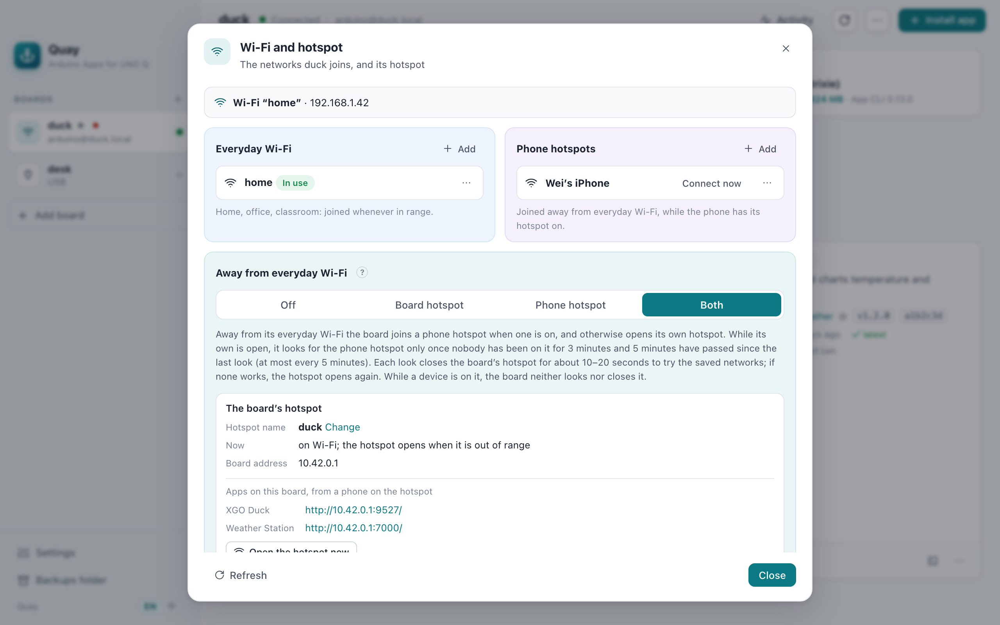

<p align="center"></p>

<h1 align="center">Quay</h1>

<p align="center">Deploy Arduino Apps from any git repository to an Arduino® UNO Q — and keep them up to date without losing their data.</p>

<p align="center"><a href="README.zh-CN.md">中文说明</a></p>

<p align="center"></p>

> [!NOTE]
> **Quay is an independent project for any Arduino App.** It is not affiliated with or endorsed by Arduino, or by Luwu Dynamics (陆吾智能), the maker of XGO-Duck.
>
> - **XGO-Duck is only one custom profile.** It is the one Quay ships today, and the example app in these screenshots. The profile was written for Quay, not by Luwu Dynamics.
> - **XGO-Duck itself** is at [github.com/LuwuDynamics](https://github.com/LuwuDynamics). Its app is [xgoduck_runtime_arduino](https://github.com/LuwuDynamics/xgoduck_runtime_arduino); get support for the robot there.
> - Arduino® and UNO™ are trademarks of Arduino S.r.l.; XGO is a name of Luwu Dynamics.

## Highlights

### Fast downloads in mainland China

Boards in China often crawl through updates and Python installs. **China mirrors** tests eight mirrors from the board itself and points pip, uv and apt at the fastest. apt keeps the next fastest and the official servers as fallbacks, so one broken mirror does not stop an update. **Via this computer** sends what has no mirror (Arduino's own packages, App Lab's update) through your computer and its proxy while Quay is connected. Both switch off cleanly and never turn on by themselves.

<p align="center"></p>

### Custom apps: what an app needs, done for it

Apps in the **Custom** tab come with a Quay profile (their own [`quay.yaml`](docs/quay-yaml.md), or one built into Quay). It tells Quay what the app needs beyond a plain install, and the install preview lists each step:
- one-time system setup;
- a step before every start;
- start and safety checks;
- the web console and shortcuts to its pages (for XGO-Duck: Calibration and Servo setup);
- policy slots;
- clean-up on erase.

Today Quay ships one such profile, for [XGO-Duck](https://github.com/LuwuDynamics/xgoduck_runtime_arduino), as a worked example. Any other app brings its own `quay.yaml`, and it works the same way.

For robots that run trained models, **Policies** installs models other people trained, checks each one against the app before it reaches the board, and keeps your choice across updates. XGO-Duck reads its models from the community collection [awesome-xgo-duck](https://github.com/caoxg/awesome-xgo-duck).

<p align="center"></p>

### System updates, under control

See what the board's update would install and how much it downloads, before anything happens. Download first, even while an app is running, and install later. Two progress bars show the time left. Leave out the on-board desktop (App Lab, Chromium) when you use the board from a computer. The update runs on the board by itself, so a dropped Wi‑Fi link does not break it, and App Lab is not needed.

<p align="center"> </p>

### Apps that follow GitHub

Install from any repository, branch or tag. Quay remembers where each app came from. When the branch moves on, the card says how many commits are new and what the latest one is, with a red dot on Update. Updating keeps `data/` (calibration, settings) and backs it up first. Apps installed some other way show GitHub's latest commit too, and one click reinstalls them through Quay.

<p align="center"></p>

### Reachable away from home

Out of the house there is no Wi‑Fi the board knows, and you can no longer reach it from a phone. Save the phone's hotspot next to the board's everyday Wi‑Fi and pick an away plan: the board opens a hotspot of its own (open `http://10.42.0.1` on the phone), joins the phone's hotspot, does both (the phone first), or stays offline. Back home it returns to its Wi‑Fi by itself, and never while a phone is still on its hotspot. The Network card always says what the plan is (*Away hotspot: …*), and **Connect now** switches the board to a saved network to try it at home. On Duck OS, Quay stays out of the way of Duck Setup's own hotspot ([how](#duck-oss-own-hotspot-and-how-quay-stays-out-of-its-way)).

<p align="center"></p>

## Everything else

Quay is a small desktop app and command-line tool for the Linux side of the Arduino UNO Q. Point it at a git repository (or a folder on your computer) and it installs the app on the board, keeps the app's `data/` folder across updates, backs it up, and drives the board's own `arduino-app-cli` to start, stop, and choose the app that runs at boot.

It is what you would otherwise do by hand over SSH, and an alternative to re-flashing a board image just to get a new app version.

- **Any git repository, any ref.** Pick a branch, tag, or commit. The repository is fetched on your computer, so the board needs no GitHub access and no git credentials.
- **Updates that keep your data.** `data/` (calibration, settings, recordings) is preserved on every update. A backup is taken first by default.
- **Backup, restore, export.** Backups are `.tgz` files of `data/` with a small manifest that records the board they came from. Exports are App Lab–compatible zips.
- **Uses the board's tools.** Lifecycle goes through `arduino-app-cli`, so App Lab sees exactly the same apps and states.
- **Per-app hooks, only when needed.** An app can ship a [`quay.yaml`](docs/quay-yaml.md) for one-time system setup, steps that must run before start, health and safety checks, shortcuts, policy slots and uninstall cleanup. Apps without one deploy generically.
- **Policies.** Install trained models (ONNX) from policy indexes or a file. Each one is verified (SHA-256, input/output shapes, joint order) before it is uploaded, and rolled back if the app does not start with it. See [Policies](#policies).
- **The app's own console, one click away.** Quay opens the web UI an app serves (from `app.yaml` `ports`, or `web` in `quay.yaml`).
- **Finds your boards.** Boards on the local network show up by themselves (they announce `_arduino._tcp` over mDNS). A board's name in Quay is its own hostname — the name App Lab shows and `NAME.local` — and renaming it in Quay renames the board.
- **System updates without App Lab.** Quay lists what the board's update would download (on a fresh board, hundreds of MB) and runs the board's own `arduino-app-cli system update`: everything, or only the Arduino packages as App Lab's update does. Everything goes in two rounds, App Lab's packages first, so the apt rules they bring (Arduino's pins) already decide the rest; in one round the UNO Q loses its sound card until a second update puts Arduino's audio configuration back. It can also leave out the on-board desktop packages (App Lab, Chromium) a board used from a computer does not need, still doing what App Lab's update does besides apt: it refreshes the Arduino library and platform indexes, then runs `arduino-app-cli system init` (the Arduino platform, the libraries and build tools the example apps use, the app images) and `system cleanup` (images no longer needed). Otherwise the first app start after the update would download all that, unpacking the microcontroller's build tools for minutes. The update runs detached on the board, so a dropped Wi‑Fi link does not interrupt it.
- **Faster downloads where the board is slow.** `quay mirror cn` tests eight mirrors in mainland China from the board itself and points pip, uv and apt's Debian packages at the fastest; apt also gets the next fastest and the official servers to fall back to by itself if a mirror breaks. `quay relay on` lets the board download through your computer (and its proxy) while Quay is connected. Both are separate, reversible commands, never applied implicitly.
- **Reachable away from home.** Save a phone's hotspot next to the board's everyday Wi‑Fi, and choose what the board does when that Wi‑Fi is out of range: open a hotspot of its own (a phone then reaches the app at `http://10.42.0.1`), join the phone's hotspot, try the phone first and fall back to its own hotspot, or stay offline. It goes back to its Wi‑Fi by itself. See [Wi‑Fi and the away plan](#wifi-and-the-away-plan).
- **SSH and USB.** Wi‑Fi/Ethernet over SSH (agent, key files, or password), and USB through `adb`. A board Quay knows both ways is reached over the network first, and over the cable when the network does not answer and the board is plugged in; the way shown next to its name at the top switches to one way only. When the board goes away (switched off, out of the Wi‑Fi, the cable out), the window says so within seconds, and Quay connects again by itself as soon as the board is back on the network or plugged in. When nothing answers, the error lists every address tried and why it failed, after a second try a few seconds later.
- **Updates itself, safely.** Quay checks its GitHub releases twice a day and offers a newer version; one click downloads it (through your proxy), checks that the release is signed with the Quay release key and that the file matches its checksum, replaces the app and restarts it. Nothing is installed without your click. `quay self-update` does the same from the command line.
- **Native and small.** The app uses the system web view (WebKit on macOS and Linux, WebView2 on Windows) through [Wails v3](https://v3.wails.io); there is no bundled Chromium. One binary is both the app and the CLI.

## Install

Download the file for your system from the releases page.

| System | File | Notes |
|---|---|---|
| macOS 12+ (Apple silicon and Intel) | `Quay-…-macos-universal.dmg` | Drag Quay to Applications. The build is ad hoc–signed and not notarized: on first launch, open **System Settings → Privacy & Security** and click **Open Anyway**, or run `xattr -dr com.apple.quarantine /Applications/Quay.app`. |
| Windows 10/11 (x64, ARM64) | `Quay-…-windows-amd64.zip` / `-arm64.zip` | Unzip anywhere. `Quay.exe` is the app; `bin\quay.exe` is the CLI (add `bin` to `PATH`). Needs the Microsoft Edge WebView2 runtime, which ships with Windows 11 and current Windows 10. |
| Debian 12+, Ubuntu 22.04+ | `quay_…_amd64.deb` / `_arm64.deb` | `sudo apt install ./quay_…_amd64.deb`. Then start Quay from the menu, or run `quay`. |
| Other Linux | `quay-…-linux-amd64.tar.gz` / `-arm64.tar.gz` | Needs GTK 3 and WebKitGTK 4.1 (`libwebkit2gtk-4.1-0`). Run `./quay`, or `./install.sh` to add it to your menu. |
| Command line only | `quay-cli-…-<os>-<arch>` | A single static binary with no GUI dependencies, for scripts and servers. |

On macOS the CLI is inside the app: `/Applications/Quay.app/Contents/MacOS/quay`. A symlink makes it handy:

```bash
sudo ln -s /Applications/Quay.app/Contents/MacOS/quay /usr/local/bin/quay
```

For USB connections, install `adb` from Android SDK platform-tools (`brew install android-platform-tools`, `apt install adb`, or Google's download). Quay takes the one on `PATH`, or Android Studio's or Homebrew's when that one is missing or too old; `QUAY_ADB` names another.

## The app

Run Quay without arguments, or open it from the dock, Start menu or application menu.

1. **Add a board.** Pick it from the boards Quay finds on your network, enter its address (for example `duck.local` or `192.168.1.42`), or choose it from the USB list. Quay connects, names the board after itself (its hostname), remembers its host key, and asks for the password only when no SSH key works. Adding a saved board the other way (over USB when it was saved by its address, or the other way round) adds that way to it.
2. **Install an app.** Choose from **Custom** (apps that come with a Quay profile), paste a git URL (`owner/repo` works for GitHub), or pick a local folder. Quay shows what it found — app name, ref, commit, profile — before anything touches the board.
3. **Run it.** Each app card shows its state, where it came from, its data files and whether it runs at boot. **Console** opens the app's own web UI. The ⋯ menu has update, logs, backup, restore, export, system setup and erase.
4. **Keep the board current.** The **System** card shows the pending system updates; click it to see what they are, choose everything or Arduino's packages only, and install. The board menu (⋯ at the top) also renames the board.
5. **Settings and updates.** **Settings** (bottom left) holds what Quay itself does, so far whether it updates its profiles by itself. When a newer Quay is out, a button above it offers the update.
6. **A new board.** A board fresh from the box, or just re-flashed, has no SSH and no usable password until App Lab's first setup. Connect it over USB and Quay offers **First setup**: a name, a password, Wi‑Fi, and SSH, done with the commands the board image allows without a password. If this computer then reaches the board over Wi‑Fi, the saved board switches to SSH and the cable can come out; Quay trusts the host keys it read over USB, so a re-flashed board needs no "host key changed" clean-up. **Set the board's password** (board menu) works the same way: over USB it needs no current password.
7. **Take it out.** The **Network** card opens the board's Wi‑Fi: everyday networks, phone hotspots, and what the board does away from its Wi‑Fi (see [Wi‑Fi and the away plan](#wifi-and-the-away-plan)).

Long operations run in the **Activity** panel with their steps and logs. You can keep working while they run.

Apps whose profile declares policy slots (the duck does) get a **Policies** button: a library of models other people trained, read from the community index the profile names (for the duck, the unofficial [awesome-xgo-duck](https://github.com/caoxg/awesome-xgo-duck)), plus **From a file…** for your own exports. See [Policies](#policies).

If an app's safety check refuses to be stopped (the duck while its servos hold torque, for example), Quay shows the app's reason and lets you cancel or **Force anyway**.

## The command line

```text
quay [command] [flags]

Boards       board scan · board add ADDRESS [--key FILE] [--default] [--upload-key] · board ls · board rm NAME · board default NAME
             board usb · board via NAME auto|network|usb · upload-key
Apps         status · deploy REPO|DIR · update APP · start|stop|restart APP · autostart APP|none · logs APP [-f]
             open APP · backup APP · restore APP FILE · export APP · erase APP
Board        upgrade [--check] [--arduino-only] [--skip-desktop] · rename NAME · prepare APP [--revert]
             mirror cn|off|test|list · relay on|off
Network      wifi [ls|scan] · wifi add NAME [--phone] [--hidden] [--open] · wifi set NAME --phone[=false] · wifi rm NAME
             hotspot [board|phone|both|off] [--name NAME] [--new-password] · hotspot open|close
Policies     policy list APP · policy search [PROFILE] · policy install APP ID|FILE.onnx [--slot S] · policy restore APP [SLOT…]
             policy inspect FILE.onnx [--app PROFILE] · policy index [add|rm URL]
Other        refs REPO · shell · system [fix ID] · profiles [--refresh] [--auto on|off] · self-update [--check] · licenses · gui
Global       -b/--board NAME · -H/--host ADDRESS · --json
```

`ADDRESS` is `host`, `user@host[:port]` (user `arduino` by default), `adb`, or `adb:SERIAL`. `board via` chooses how Quay reaches a board it knows both ways: `auto` (the network first, then USB), `network` or `usb`. `APP` is the folder name under `~/ArduinoApps` (or the app's name).

```bash
# Find boards on the network and save one; it is named after its hostname
quay board scan
quay board add duck.local --default

# Install the latest default branch, a tag, or a local folder
quay deploy LuwuDynamics/xgoduck_runtime_arduino
quay deploy https://github.com/me/weather --ref v1.2.0
quay deploy ./my-app --folder weather_station

# What is on the board?
quay status

# Start it at boot, follow its logs, open its console
quay autostart xgoduck_runtime_arduino
quay logs xgoduck_runtime_arduino -f
quay open xgoduck_runtime_arduino

# Update from the repository it came from (data/ is kept and backed up first)
quay update xgoduck_runtime_arduino
quay update xgoduck_runtime_arduino --ref next-audio-video-tof

# Back up, restore, export for App Lab
quay backup xgoduck_runtime_arduino -o ~/duck-backups
quay restore xgoduck_runtime_arduino ~/duck-backups/xgoduck_runtime_arduino-9f3a21c7-20261023-130501.tgz
quay export xgoduck_runtime_arduino -o duck.zip

# Remove an app (asks you to type its folder name; backs up data/ first)
quay erase weather_station

# Update the board's system, without the on-board desktop packages
quay upgrade --check
quay upgrade --skip-desktop

# Rename the board (it becomes goose.local; App Lab shows the new name too)
quay rename goose

# A fresh or re-flashed board over USB: password, Wi-Fi, SSH; then use it over the network
quay -H adb passwd
quay -H adb wifi add home
quay -H adb ssh on
quay board add goose.local

# Away from home: save the phone's hotspot; the board joins it, else opens a hotspot of its own
quay wifi add "Wei's iPhone" --phone
quay hotspot both
quay wifi connect "Wei's iPhone"   # try it at home; turn the hotspot off to send the board back
```

`--json` turns any command's progress into one JSON event per line, for scripts and other front ends.

### What `deploy` does

1. Fetches the repository on your computer (a cached bare clone) and checks `app.yaml` and `python/main.py`.
2. Connects to the board and checks the app's safety probe, if it has one.
3. Backs up `data/` to your computer, then stops the app if it is running.
4. Uploads the files and replaces everything in the app folder **except** `data/` and App CLI's `.cache/`.
5. Updates the board's Arduino library index if it does not list a library version the sketch pins (`sketch/sketch.yaml`). The OS image ships the index of its build day, and App CLI refreshes it only during its own system update (App Lab's update), so on a freshly flashed board, or one updated through plain apt, a newer pin would otherwise fail to compile.
6. Runs the app's `before_start` hook, if any.
7. Starts the app and waits until it is up.

`deploy` never changes which app runs at boot (that is `quay autostart`) and never changes system settings (that is `quay prepare`). Each command does one thing.

### Board-wide settings

- `quay prepare APP` applies the one-time system change an app declares, such as a serial link speed. It needs `sudo`: Quay tries passwordless sudo, then the SSH login password, then asks. `--revert` undoes the change.
- `quay mirror cn` first tests the built-in mirrors (Tsinghua TUNA, USTC, Alibaba Cloud, Tencent Cloud, Huawei Cloud, BFSU, Nanjing University, SJTU — `quay mirror list`) from the board, then points pip and uv at the fastest PyPI mirror and apt's Debian packages at the fastest Debian mirror. apt is set up with a mirror list (`mirror+file:`): when the chosen mirror fails it moves on by itself to the next fastest ones and finally to deb.debian.org; pip gets the second fastest as an extra index. `--use ID` picks a mirror without testing, `--index URL` / `--debian URL` use mirrors of your own, `--no-pypi` / `--no-debian` leave one alone. `quay mirror test` only measures (Debian download speed and latency from the board, PyPI latency, the official servers for comparison). `quay mirror off` restores the previous files exactly. In the app, the **China mirrors** card opens the same test as a table to pick from.
- `quay relay on` installs a small apt hook on the board (sudo). While Quay is connected — during `quay upgrade`, and whenever the app is open — the board's package downloads go through your computer, and through its proxy if it has one (the system proxy settings, or `--upstream http://127.0.0.1:7890`). When Quay is not connected the board downloads directly, as before. This covers Arduino's own packages, which have no mirror. `quay relay off` removes the hook.
- `quay upgrade` runs the board's system update. It refreshes the package lists, shows what would be installed and how much it downloads, asks, then runs `arduino-app-cli system update`, in two rounds: App Lab's packages (`arduino-*`) first, then the rest. `--arduino-only` stops after the first, which is the update App Lab runs; `--skip-desktop` leaves out the on-board App Lab and Chromium (about 290 MB on a fresh board). The board image lets these commands run without a password. The job runs detached on the board: if the connection drops, run `quay upgrade` again to follow it.
- `quay upload-key` appends your SSH public key (`~/.ssh/id_ed25519.pub`, `id_ecdsa.pub` or `id_rsa.pub`) to the board's `~/.ssh/authorized_keys`, like `ssh-copy-id`, so Quay and `ssh` log in without a password. `board add --upload-key` (a checkbox in the app's **Add board**) does it right away; the board menu has it too.
- `quay rename NAME` renames the board the way App Lab does (`arduino-app-cli system set-name`), re-announces it as `NAME.local`, and updates the saved board.

### Wi‑Fi and the away plan

The board joins its **everyday Wi‑Fi** (home, office, classroom) whenever one is in range. `quay wifi` lists the saved networks, `quay wifi scan` the ones in range, `quay wifi add NAME` saves one (it asks for the password), `quay wifi rm NAME` forgets one. Adding a network never changes the current connection. `quay wifi connect NAME` (**Connect now** in the app) switches the board to a saved network right away, to try a phone hotspot at home, say. Quay loses the board then, unless this computer joins that network too; turning the phone's hotspot off sends the board back to its everyday Wi‑Fi.

A network saved with `--phone` is a **phone hotspot**: the board joins it only as the **away plan** says, and after any everyday Wi‑Fi. `quay wifi set NAME --phone` (or `--phone=false`) changes an existing network. The away plan is what the board does when none of its everyday Wi‑Fi is in range:

| `quay hotspot …` | Away from its everyday Wi‑Fi, the board… |
|---|---|
| `off` | stays offline; phone hotspots are not joined either |
| `board` | opens a hotspot of its own. Join it from a phone and open `http://10.42.0.1` (and the app's port, e.g. `http://10.42.0.1:9527`). Phone hotspots are not joined. |
| `phone` | joins a saved phone hotspot while the phone has it on. The phone keeps its internet; the board's address is among the hotspot's connected devices. |
| `both` | joins a phone hotspot if one is on, otherwise opens its own hotspot |

`board` and `both` install a small service on the board, [`quay-hotspot`](internal/remote/hotspot/README.md) (sudo); the first time, Quay asks for the hotspot's password, and names the hotspot after the board unless you pass `--name`. The service opens the hotspot 45 seconds after boot without Wi‑Fi, or a minute after losing it. Once nobody has been on the hotspot for 3 minutes, it looks for Wi‑Fi at most every 5 minutes: it closes the hotspot for about 10–20 seconds, scans, and joins a saved network it sees (everyday Wi‑Fi first, then phone hotspots under `both`), or opens the hotspot again. While a device is on the hotspot it never looks, so it never drops a connected phone. Under `both`, a phone hotspot turned on after the board opened its own is therefore found at the next look, within about 5 minutes. `quay hotspot open` opens it now, to try it (the board leaves its Wi‑Fi, so this connection drops; with nobody on it, the board returns within about 5 minutes); `quay hotspot close` goes back to Wi‑Fi now. `off` and `phone` remove the service and keep the hotspot's name and password for later. A hotspot set up by Duck Setup is left alone.

#### Duck OS's own hotspot, and how Quay stays out of its way

Duck OS (Luwu Dynamics' image for XGO-Duck) has a hotspot of its own: **Use XGO-Duck hotspot** in their Duck Setup app (over USB) creates a NetworkManager profile `Duck-Setup-hotspot-…` ("XGO-Duck", also on `10.42.0.1`) that comes up at every boot with priority 999, ahead of any Wi‑Fi, and Duck Setup deletes the Wi‑Fi profile it had saved before. It is a manual switch that stays until Duck Setup switches back. On the stock Arduino image Duck Setup cannot open it (the helper is only in Duck OS).

The board has one Wi‑Fi radio, so only one hotspot can be up. Quay's rules:

- **It never removes or changes Duck Setup's profiles by itself.** Quay only touches its own hotspot profile (`quay-hotspot`), the networks you save in Quay, and `/etc/quay/network.json`; Duck Setup only removes profiles named `Duck-Setup-…`.
- **It steps aside while another hotspot is up.** When Duck Setup's hotspot is running, `quay-hotspot` neither opens its own nor closes the other one, and it never joins another tool's hotspot when it looks for Wi‑Fi.
- **It says who is in charge.** The [Duck OS system profile](https://github.com/caoxg/quay-profiles/blob/main/systems/duck-os.yaml) recognises the image and names Duck Setup's hotspot. The **Network** card then reads *Away hotspot: controlled by Duck OS, starts by itself* (or *does not start by itself*), and the **Wi‑Fi and hotspot** dialog warns while it comes up at boot.
- **You decide.** While Duck Setup's hotspot comes up at boot, it wins over Quay's away plan (and when Quay's service closes its own hotspot to look for Wi‑Fi, NetworkManager may bring Duck Setup's up instead). The warning's **Don't open it at boot** turns only its autostart off (`quay system fix duck-setup-hotspot`): the profile stays, Duck Setup can still switch to it, and from then on Quay's away plan decides. With its autostart off and no away plan set in Quay, the card keeps naming Duck OS.

In the app, the **Network** card opens all of this in one dialog.

### Policies

Apps that run trained models (ONNX policies) can declare their model files as *slots* in `quay.yaml` (`policies:`). Quay then installs models other people trained in their place:

```bash
quay policy search xgoduck                                  # what the indexes offer
quay policy install xgoduck_runtime_arduino walk-luwu-2026-09-22
quay policy install xgoduck_runtime_arduino ./model_5500.onnx --slot roller --name "Roller 5500"
quay policy list xgoduck_runtime_arduino                    # what each slot holds
quay policy restore xgoduck_runtime_arduino                 # back to the stock models
```

1. **Download and verify.** The model is downloaded to your computer, and its SHA-256 and size are checked against the index.
2. **Check against the slot.** Quay reads the ONNX file itself: input and output shapes, required metadata, and metadata that must match the stock model in that slot (for the duck: `joint_names` and `observation_names`, so a model trained for another joint order is refused). `--force` overrides a failed check.
3. **Swap.** The app is stopped (after its safety check), the model goes into place, and the app starts again. If the app does not come up with the new model, the previous one is put back and the app is started again.
4. **Keep it.** Installed models and the stock originals live in the app's `data/quay-policies/` on the board, so backups include them. After every deploy or update, Quay puts the installed models back before the app starts.

Indexes are YAML files anyone can host. Each profile names its community index, and `quay policy index add URL` adds your own (a team's or a class's). `quay policy inspect model.onnx --app xgoduck` shows a model's shapes and metadata and prints an index entry to publish it.

## App profiles (`quay.yaml`)

Most apps need nothing. An app that needs more puts a `quay.yaml` next to its `app.yaml`:

```yaml
system:                      # one-time root setup, applied with `quay prepare`
  description: Sets the router serial link to 2 Mbps.
  check: grep -qs 2000000 /etc/systemd/system/arduino-router.service.d/90-baud.conf
  apply: bash tools/router-2m.sh
  revert: rm -f /etc/systemd/system/arduino-router.service.d/90-baud.conf && systemctl daemon-reload && systemctl restart arduino-router
before_start:                # after every deploy, before the app starts
  run: python3 tools/prepare-bridge.py
health: { url: http://127.0.0.1:9527/api/status, timeout: 240 }
safety: { url: http://127.0.0.1:9527/api/status, field: enabled, message: Turn torque off first. }
web: { port: 9527 }
```

The full reference is in [docs/quay-yaml.md](docs/quay-yaml.md). For known apps that do not ship a `quay.yaml` yet, Quay has profiles of its own (`quay profiles` lists them). They are published in [quay-profiles](https://github.com/caoxg/quay-profiles), separately from Quay: Quay carries a copy and fetches a newer one about twice a day, so a profile can be fixed without a Quay release. Currently there is one, for [XGO-Duck](https://github.com/LuwuDynamics/xgoduck_runtime_arduino). It was written for Quay and only drives scripts that already live in that repository; it is not maintained by Luwu Dynamics. A `quay.yaml` in the repository always wins.

### Board systems

The same repository has **system profiles** for board systems other than the stock Arduino image, such as Duck OS. A system profile recognises the system by a file it ships (Duck OS: `/etc/duck-release.json`), and lists what the system does differently that matters to Quay — for Duck OS, the Duck Setup hotspot that comes up at every boot and would override Quay's away plan. The **System** card then shows the system and version, and each finding appears where it matters, with a button for its fix. `quay system` shows the same, and `quay system fix ID` applies a fix.

A profile fetched from the network only describes: files to look for (and which JSON keys to read, nothing else), saved network profiles to match, and which of Quay's built-in actions applies (stop a NetworkManager profile coming up by itself; delete one that is not in use). It cannot make Quay run a command of its own, and every fix waits for your click.

## Files and settings

| What | Where |
|---|---|
| Saved boards, language, your policy indexes | `config.json` in the Quay config folder: `~/Library/Application Support/Quay` (macOS), `%AppData%\Quay` (Windows), `~/.config/Quay` (Linux) |
| Trusted board host keys | `known_hosts` in the same folder (your `~/.ssh/known_hosts` is read too, never written) |
| Backups | `backups/` in the same folder, unless you choose another |
| Repository cache | `Quay/repos` in the user cache folder |
| Policy downloads and index copies | `Quay/policies` in the user cache folder |
| The newest copy of the profiles repository | `Quay/profiles` in the user cache folder |
| The last check for a newer Quay | `Quay/update.json` in the user cache folder |
| Quay's own log (what each operation did, one file a day, kept two weeks; **Settings → Show the log**) | `~/Library/Logs/Quay` (macOS), `Quay\logs` in `%LocalAppData%` (Windows), `~/.local/state/quay/logs` (Linux) |
| Installed policies (on the board) | `~/ArduinoApps/APP/data/quay-policies/` (models, stock originals, `state.json`) |
| Away plan and phone hotspots (on the board) | `/etc/quay/network.json`; networks Quay saves are NetworkManager keyfiles `quay-wifi-*.nmconnection` and `quay-hotspot.nmconnection` in `/etc/NetworkManager/system-connections/` |
| The hotspot service (on the board) | `/usr/local/lib/quay/quay-hotspot`, `quay-hotspot.service`; its state in `/run/quay-hotspot/` |

| Environment variable | Effect |
|---|---|
| `QUAY_HOME` | Use another config folder |
| `QUAY_BOARD` | Default board for the CLI (overridden by `--board`) |
| `QUAY_GIT_TOKEN` | Token for private HTTPS repositories (SSH URLs use your ssh-agent) |
| `QUAY_ADB` | Path to `adb` |

## Building from source

Requires Go 1.26.

```bash
make            # GUI + CLI for this machine → dist/quay-<os>-<arch>
make cli        # CLI only, no cgo
make app        # macOS: dist/Quay.app for this Mac
make test       # vet, unit tests, frontend syntax check
make e2e        # end-to-end tests against a fake UNO Q in Docker (sshd, sudo, a stub arduino-app-cli)
make preview    # the UI with a mock backend: http://127.0.0.1:8765/?mock (add &os=windows or &os=linux)
make release    # everything below + CLI binaries for six platforms + SHA256SUMS
make licenses   # regenerate the third-party license list after changing dependencies
make mac        # universal .dmg and .zip (macOS with Xcode command-line tools)
make windows    # Windows zips, cross-compiled from any OS (no cgo needed)
make linux      # .deb and .tar.gz for amd64 and arm64, built in Debian 12 containers (Docker)
```

### Releases

`make release` builds every package, writes `dist/SHA256SUMS` and signs it (`dist/SHA256SUMS.sig`) with the release key, which `go run ./build/sign keygen` created once at `~/.config/quay/release-signing.key` (keep a copy somewhere safe; its public half is in `internal/selfupdate`). A tag `v*` makes GitHub Actions build and sign the same files (the key is the secret `QUAY_SIGNING_KEY`) into a draft release. Self-update refuses a release without a valid signature. Every release's notes end with [`build/release-notes-footer.md`](build/release-notes-footer.md), how to open the unsigned app on macOS, until Quay is signed with an Apple Developer ID.

A native Linux GUI build needs `libgtk-3-dev` and `libwebkit2gtk-4.1-dev`. Without cgo, or with `-tags nogui`, Quay builds as a pure-Go CLI.

### Layout

```text
main.go                 GUI when started without arguments, CLI otherwise
internal/board          SSH and adb transports, host keys, prompts
internal/discover       finding boards on the network (mDNS, no extra dependencies)
internal/relay          the download relay's HTTP proxy
internal/mirror         the mirrors in mainland China and how a speed test ranks them
internal/source         git fetch (go-git) and local folders → an upload bundle
internal/remote         the small bash/python scripts run on the board
internal/remote/hotspot the board's hotspot service (Python, with its own tests)
internal/core           deploy, update, lifecycle, backup/restore, erase, prepare, mirror
internal/profile        quay.yaml parsing, and app profiles from the profiles repository
internal/sysprofile     system profiles: recognising a board's system and what it does differently
internal/hub            Quay's copy of the quay-profiles repository (builtin/), and fetching a newer one
internal/cli            the command line (cobra)
internal/legal          copyright notice and the generated third-party license list (embedded)
internal/gui            the Wails service and the frontend (plain HTML/CSS/JS, no build step)
test/fakeboard, test/e2e  a Docker "UNO Q" and the end-to-end suite
build/                  icons, Info.plist, Windows resources, Linux packaging
```

## License

Quay is licensed under the [Apache License 2.0](LICENSE). Copyright 2026 Xiaogang Cao.

It includes third-party software under their own licenses (MIT, BSD, ISC and Apache-2.0). The full list ships with every package as `THIRD_PARTY_LICENSES.txt`, and `quay licenses` (or **About** in the app) shows it. After changing dependencies, run `make licenses`. A test fails if the list is out of date.

---

Arduino® and UNO™ are trademarks of Arduino S.r.l. Quay is an independent project and is not affiliated with Arduino.
