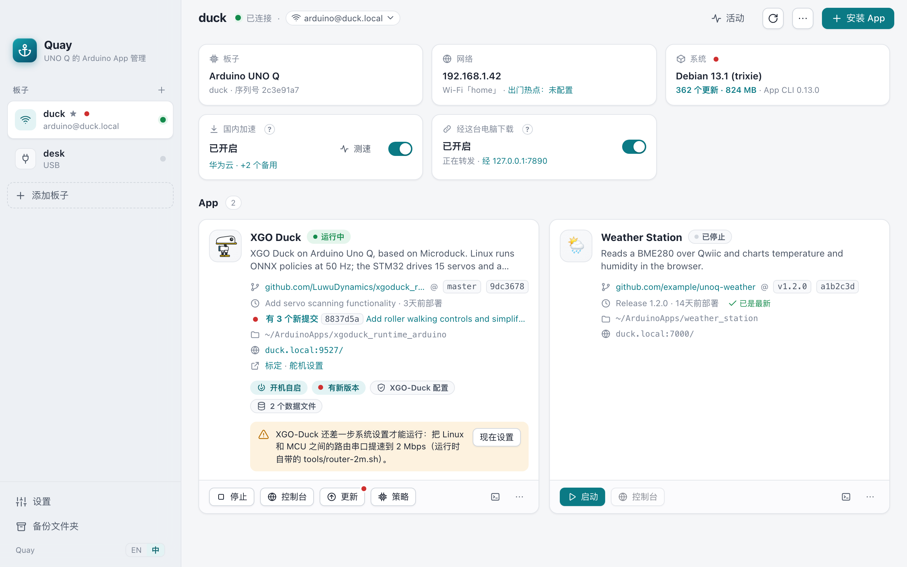
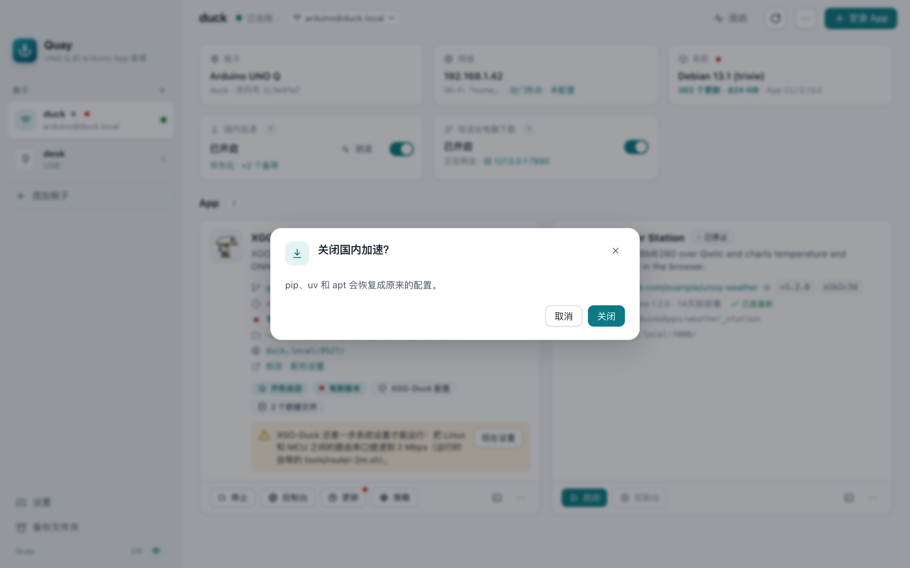
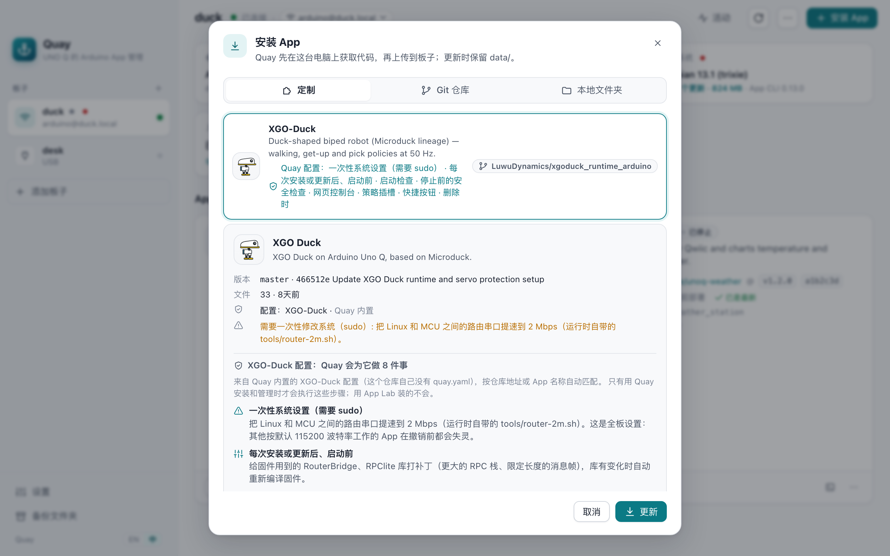
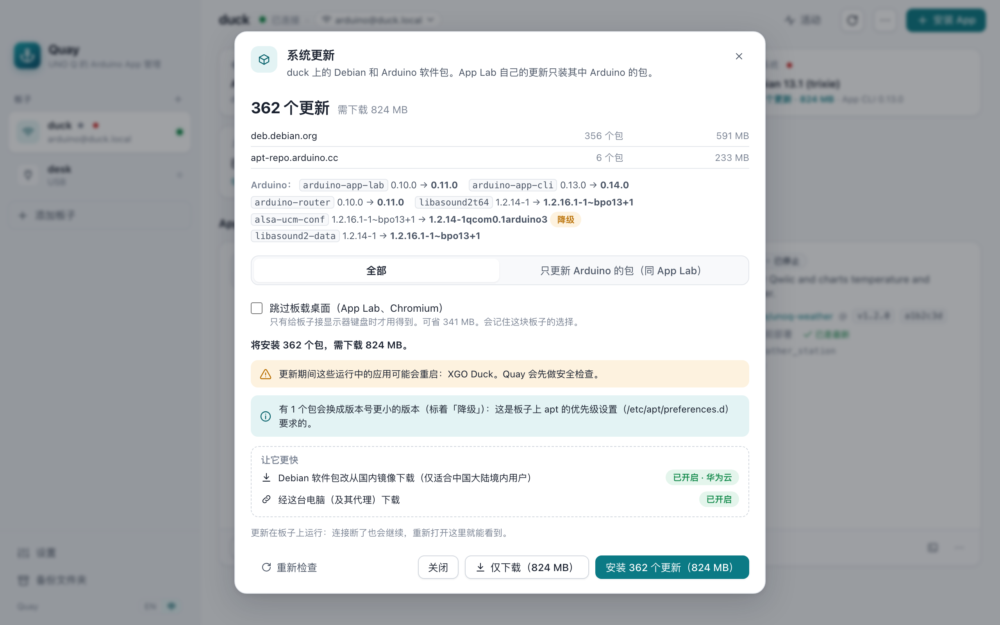
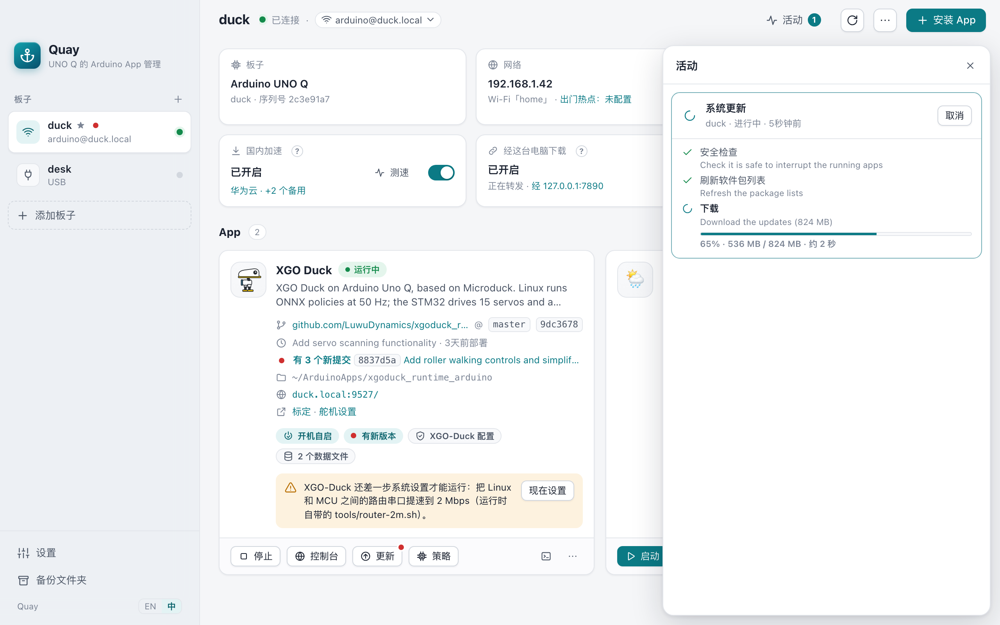
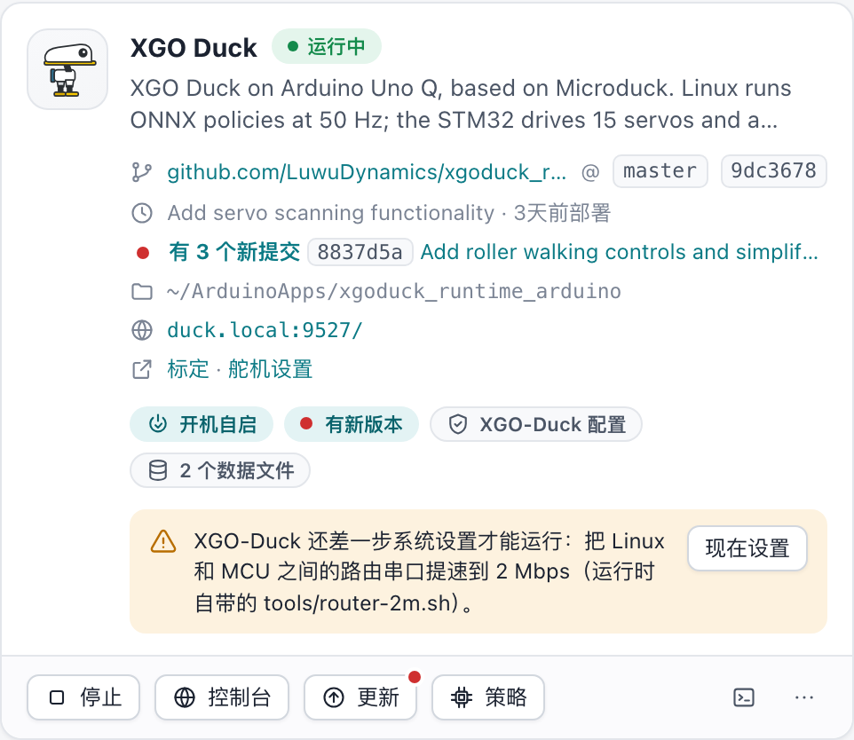
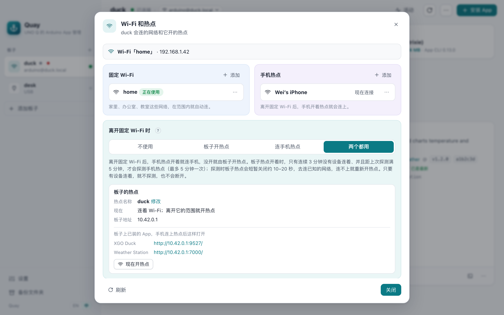

<p align="center"></p>

<h1 align="center">Quay</h1>

<p align="center">从任意 git 仓库把 Arduino App 部署到 Arduino® UNO Q，更新时不丢数据。</p>

<p align="center"><a href="README.md">English</a></p>

<p align="center"></p>

> [!NOTE]
> **Quay 是面向所有 Arduino App 的独立项目。** 与 Arduino 无关联，也与 XGO-Duck 的开发方陆吾智能（Luwu Dynamics）无关联，未获两者认可。
>
> - **XGO-Duck 只是其中一份定制配置。** 它是 Quay 目前自带的唯一一份，也是这些截图里的示例 App。这份配置是为 Quay 编写的，不是陆吾智能出品。
> - **XGO-Duck 本身**在 [github.com/LuwuDynamics](https://github.com/LuwuDynamics)，它的 App 是 [xgoduck_runtime_arduino](https://github.com/LuwuDynamics/xgoduck_runtime_arduino)。机器人本身的问题请到那里找官方支持。
> - Arduino® 和 UNO™ 是 Arduino S.r.l. 的商标；XGO 是陆吾智能使用的名称。

## 亮点

### 国内下载加速

板子在国内做系统更新、装 Python 包常常慢得要命。

- **国内加速**：在板子上给 8 个国内镜像测速，把 pip、uv 和 apt 指向最快的那个。apt 还会配好次快的镜像和官方源作为备用，一个镜像出问题，更新也不会断。
- **经这台电脑下载**：没有镜像的部分（Arduino 自己的包、App Lab 的更新），在 Quay 连着时经你的电脑和它的代理下载。

两个都能干净地关掉，也都不会自己打开。

<p align="center"></p>

### App 定制：App 需要什么，Quay 替它做

「定制」里的 App 都带一份 Quay 配置：App 自己的 [`quay.yaml`](docs/quay-yaml.md)，或者 Quay 内置的。配置告诉 Quay 这个 App 除了普通安装还需要什么，安装预览里会逐条列出：
- 一次性系统设置；
- 每次启动前的准备；
- 启动检查和安全检查；
- 网页控制台和快捷按钮（XGO-Duck 的是「标定」「舵机设置」）；
- 策略插槽；
- 删除时的清理。

目前 Quay 自带一份这样的配置，用于 [XGO-Duck](https://github.com/LuwuDynamics/xgoduck_runtime_arduino)，作为示例。其他 App 可以自带 `quay.yaml`，用法完全一样。

对运行训练模型的机器人，**策略**功能可以安装别人训练好的模型：上板前先检查是否和 App 匹配，App 更新后也会保留你的选择。XGO-Duck 的策略来自社区合集 [awesome-xgo-duck](https://github.com/caoxg/awesome-xgo-duck)。

<p align="center"></p>

### 管理系统更新

动手之前，先看清板子这次更新要装什么、要下载多少：
- 可以先下载，App 运行时也行，等板子空闲时再安装；
- 下载和安装各有一个进度条，显示还要多久；
- 用电脑操作板子的话，可以跳过板载桌面（App Lab、Chromium）；
- 更新在板子上独立运行，Wi‑Fi 断了也不会中断，也不需要 App Lab。

<p align="center"> </p>

### App 随 GitHub 更新

可以从任意仓库、分支或标签安装，Quay 会记住每个 App 的来源：
- 分支有新提交时，卡片上会显示有几个新提交、最新一个是什么，「更新」按钮上会出现小红点；
- 更新会保留 `data/`（标定、设置），更新前还会先备份；
- 不是用 Quay 装的 App 也会显示 GitHub 上的最新提交，点一下就能改用 Quay 重装。

<p align="center"></p>

### 出门也能连上

出了门，板子周围没有它认识的 Wi‑Fi，手机就连不上它了。在固定 Wi‑Fi 之外再存一个手机热点，然后选好出门时的策略：
- 板子自己开热点（手机连上后打开 `http://10.42.0.1`）；
- 板子连手机热点；
- 两个都用（先找手机热点）；
- 或者不联网。

回到家板子会自己连回固定 Wi‑Fi；有手机连着它的热点时不会关。「网络」卡片上始终写着当前的策略（「出门热点：……」），「现在连接」可以让板子马上切到某个已存网络，在家就能先试一遍。在 Duck OS 上，Quay 会避让 Duck Setup 自带的热点（[详见](#duck-os-自带的热点以及-quay-怎么避让)）。

<p align="center"></p>

## 其他功能

Quay 是给 Arduino UNO Q 的 Linux 一侧用的桌面应用，同时也是命令行工具。给它一个 git 仓库（或电脑上的一个文件夹），它就会把 App 装到板子上，更新时保留 App 的 `data/` 目录，可以备份和恢复，并通过板子自带的 `arduino-app-cli` 启动、停止应用，以及设置开机运行哪个应用。

这些事原本要 SSH 上去手动做。为了换一个 App 版本而重刷整个系统镜像，也可以改用它。

- **任意仓库、任意版本。** 分支、tag、commit 都行。仓库在你的电脑上拉取，板子不需要能访问 GitHub，也不需要 git 凭据。
- **更新不丢数据。** 每次更新都保留 `data/`（标定、设置、录制等），默认先备份。
- **备份、恢复、导出。** 备份是 `data/` 的 `.tgz`，附带记录来源板子的清单；导出是 App Lab 兼容的 zip。
- **用板子自己的工具。** 生命周期全部走 `arduino-app-cli`，App Lab 看到的应用和状态与 Quay 完全一致。
- **按需的应用钩子。** 应用可以带一个 [`quay.yaml`](docs/quay-yaml.md)，声明一次性系统设置、启动前步骤、健康与安全检查、快捷按钮、策略插槽、卸载清理。没有它就按通用方式部署。
- **策略。** 从策略索引或文件安装训练好的模型（ONNX）。上传前逐个校验（SHA-256、输入输出形状、关节顺序）；App 换上新模型后起不来，会自动换回原来的。详见[策略](#策略)。
- **一键打开应用自己的控制台。** Quay 会打开应用提供的网页界面，端口来自 `app.yaml` 的 `ports`，或 `quay.yaml` 的 `web`。
- **自动找到板子。** 局域网里的板子会自己出现在列表里（它们通过 mDNS 广播 `_arduino._tcp`）。板子在 Quay 里的名字就是它自己的主机名，也就是 App Lab 显示的名字和 `名字.local`；在 Quay 里改名就是给板子改名。
- **不用 App Lab 做系统更新。** Quay 会列出这次更新要下载什么（新板子往往有几百 MB），然后调用板子自己的 `arduino-app-cli system update`：可以全部更新，也可以像 App Lab 那样只更新 Arduino 的包。全部更新分两轮：先装 App Lab 的那组包，它们带来的 apt 规则（Arduino 的版本钉选）生效后，再装其余的包。如果一轮装完，UNO Q 的声卡会消失，要等第二次更新把 Arduino 的音频配置换回来。也可以跳过板载桌面的包（App Lab、Chromium），用电脑操作板子时用不到它们；这时 Quay 照样会做 App Lab 的更新在 apt 之外做的事：刷新 Arduino 库索引和平台索引，再执行 `arduino-app-cli system init`（Arduino 平台、示例 App 用到的库和编译工具、App 的 Docker 镜像）和 `system cleanup`（删掉不再需要的镜像）。否则这些都要等更新后第一次启动 App 时才下载，光解压单片机的编译工具就要好几分钟。更新在板子上独立运行，Wi‑Fi 断了也不会中断。
- **板子下载慢时的加速。** `quay mirror cn` 先从板子上给 8 个国内镜像测速，把 pip、uv 和 apt 的 Debian 软件包指向最快的那个；apt 还会配上测速靠前的其他镜像和官方源，某个镜像坏了会自动换下一个。`quay relay on` 让板子在 Quay 连着的时候经你的电脑（及其代理）下载。两者都是独立、可撤销的命令，不会被顺带执行。
- **出门也能连上。** 在固定 Wi‑Fi 之外再存一个手机热点，然后选好离开固定 Wi‑Fi 时板子怎么做：板子开热点（手机连上后打开 `http://10.42.0.1`）、连手机热点、先找手机热点、找不到再由板子开热点，或者干脆不联网。回到 Wi‑Fi 范围后会自己连回去。详见[Wi‑Fi 和出门时的策略](#wifi-和出门时的策略)。
- **SSH 和 USB。** Wi‑Fi/有线走 SSH（agent、密钥文件或密码），也可以用 USB（`adb`）。两种连接都记下的板子，先走网络；网络连不上、板子又插着 USB 线时，改走 USB。顶部板子名旁边的连接方式可以切换成只用其中一种。都连不上时，报错里会列出试过的每个地址和失败原因，而且是隔几秒又试了一次之后。
- **安全地自动更新。** Quay 每天两次检查 GitHub 上的新版本，有新版就提示；点一下就会下载（走你的代理）、验证发布签名和校验和、替换应用并重启。不点就什么都不装。命令行用 `quay self-update`。
- **原生、轻量。** 界面使用系统自带的 WebView（macOS、Linux 上是 WebKit，Windows 上是 WebView2），基于 [Wails v3](https://v3.wails.io)，不打包 Chromium。同一个程序既是桌面应用也是 CLI。

## 安装

从 Releases 页面下载对应系统的文件。

| 系统 | 文件 | 说明 |
|---|---|---|
| macOS 12+（Apple 芯片和 Intel） | `Quay-…-macos-universal.dmg` | 拖到"应用程序"。目前是 ad hoc 签名、未公证：首次打开时到 **系统设置 → 隐私与安全性** 点 **仍要打开**，或者执行 `xattr -dr com.apple.quarantine /Applications/Quay.app`。 |
| Windows 10/11（x64、ARM64） | `Quay-…-windows-amd64.zip` / `-arm64.zip` | 解压到任意位置。`Quay.exe` 是桌面应用，`bin\quay.exe` 是命令行（把 `bin` 加进 `PATH`）。需要 Microsoft Edge WebView2 运行时，Windows 11 和较新的 Windows 10 已自带。 |
| Debian 12+、Ubuntu 22.04+ | `quay_…_amd64.deb` / `_arm64.deb` | `sudo apt install ./quay_…_amd64.deb`，然后从应用菜单打开，或运行 `quay`。 |
| 其他 Linux | `quay-…-linux-amd64.tar.gz` / `-arm64.tar.gz` | 需要 GTK 3 和 WebKitGTK 4.1（`libwebkit2gtk-4.1-0`）。直接运行 `./quay`，或运行 `./install.sh` 加入应用菜单。 |
| 仅命令行 | `quay-cli-…-<os>-<arch>` | 单个静态二进制，没有 GUI 依赖，适合脚本和服务器。 |

macOS 上的命令行在应用包里：`/Applications/Quay.app/Contents/MacOS/quay`。建个软链接会方便很多：

```bash
sudo ln -s /Applications/Quay.app/Contents/MacOS/quay /usr/local/bin/quay
```

用 USB 连接的话，需要安装 Android SDK platform-tools 里的 `adb`（`brew install android-platform-tools`、`apt install adb`，或从 Google 下载）。Quay 先用 `PATH` 里的；没有或版本太旧时，会去找 Android Studio 或 Homebrew 装的；也可以用 `QUAY_ADB` 指定。

## 桌面应用

不带参数运行 Quay，或者从程序坞、开始菜单、应用菜单打开。

1. **添加板子。** 从 Quay 在网络里找到的板子中选一块，或者输入地址（比如 `duck.local` 或 `192.168.1.42`），或者从 USB 列表里选。Quay 连上后用板子自己的主机名给它命名，记住它的主机密钥；只有在 SSH 密钥都不可用时才会问密码。已保存的板子换一种方式再添加一次（原来按地址保存的改用 USB 添加，或者反过来），会给它补上这种连接，不会覆盖原来的。
2. **安装应用。** 从「定制」里选（带 Quay 配置的 App），或粘贴 git 地址（GitHub 可以只写 `owner/repo`），或选本地文件夹。在动板子之前，Quay 会先给你看它找到了什么：应用名、版本、commit、配置。
3. **运行。** 每张应用卡片显示状态、来源、数据文件、是否开机运行。**控制台** 按钮打开应用自己的网页界面。⋯ 菜单里有更新、日志、备份、恢复、导出、系统设置和删除。
4. **保持系统最新。** 「系统」卡片显示待安装的系统更新；点开能看到具体内容，可以选择全部更新或只更新 Arduino 的包，然后安装。顶部的板子菜单（⋯）里还可以重命名板子。
5. **设置和更新。** 左下角的「设置」里是 Quay 自身的设置，目前只有要不要自动更新配置。有新版 Quay 时，它上面会出现更新按钮。
6. **新板子。** 刚开箱或刚重刷的板子，在做 App Lab 首次设置之前，没有 SSH，也没有可用的密码。用 USB 连上后，Quay 会提供「首次设置」：起名、设密码、连 Wi‑Fi、开 SSH，用的都是板子镜像允许免密运行的命令。之后如果这台电脑能通过 Wi‑Fi 连到板子，已保存的板子会改用 SSH，USB 线就可以拔了；Quay 信任它通过 USB 读到的主机密钥，所以重刷过的板子不用再去处理「主机密钥已变」。板子菜单里的「设置板子密码」也是同样的办法：USB 连着时不需要旧密码。
7. **带出门。** 点「网络」卡片打开板子的 Wi‑Fi 设置：固定 Wi‑Fi、手机热点，以及离开固定 Wi‑Fi 时板子怎么做（详见[Wi‑Fi 和出门时的策略](#wifi-和出门时的策略)）。

耗时的操作在 **活动** 面板里显示步骤和日志，运行期间可以继续做别的事。

如果应用的配置声明了策略插槽（鸭子就有），卡片上会多一个 **策略** 按钮，里面有两部分：

- 策略库：别人训练好的模型，来自配置指定的社区索引（鸭子用的是非官方的 [awesome-xgo-duck](https://github.com/caoxg/awesome-xgo-duck)）；
- **从文件安装…**：装你自己导出的模型。

详见[策略](#策略)。

如果应用的安全检查拒绝停止（比如鸭子的舵机还带着力矩），Quay 会给出应用说的原因，并让你选择取消还是 **仍然强制执行**。

## 命令行

```text
quay [命令] [参数]

板子       board scan · board add 地址 [--key 文件] [--default] [--upload-key] · board ls · board rm 名称 · board default 名称
           board usb · board via 名称 auto|network|usb · upload-key
应用       status · deploy 仓库|目录 · update 应用 · start|stop|restart 应用 · autostart 应用|none · logs 应用 [-f]
           open 应用 · backup 应用 · restore 应用 文件 · export 应用 · erase 应用
板子系统   upgrade [--check] [--arduino-only] [--skip-desktop] · rename 名字 · prepare 应用 [--revert]
           mirror cn|off|test|list · relay on|off
网络       wifi [ls|scan] · wifi add 名称 [--phone] [--hidden] [--open] · wifi set 名称 --phone[=false] · wifi rm 名称
           hotspot [board|phone|both|off] [--name 名称] [--new-password] · hotspot open|close
策略       policy list 应用 · policy search [配置] · policy install 应用 ID|文件.onnx [--slot 插槽] · policy restore 应用 [插槽…]
           policy inspect 文件.onnx [--app 配置] · policy index [add|rm 网址]
其他       refs 仓库 · shell · system [fix ID] · profiles [--refresh] [--auto on|off] · self-update [--check] · licenses · gui
全局       -b/--board 名称 · -H/--host 地址 · --json
```

`地址` 是 `host`、`user@host[:port]`（用户默认是 `arduino`）、`adb` 或 `adb:序列号`。`board via` 选择两种连接都记下的板子怎么连：`auto`（先走网络，再用 USB）、`network` 或 `usb`。`应用` 是 `~/ArduinoApps` 下的文件夹名（或应用名）。

```bash
# 在网络里找板子，保存一块；名字就是它的主机名
quay board scan
quay board add duck.local --default

# 安装默认分支最新版、某个 tag，或本地文件夹
quay deploy LuwuDynamics/xgoduck_runtime_arduino
quay deploy https://github.com/me/weather --ref v1.2.0
quay deploy ./my-app --folder weather_station

# 板子上有什么？
quay status

# 设为开机运行、跟踪日志、打开控制台
quay autostart xgoduck_runtime_arduino
quay logs xgoduck_runtime_arduino -f
quay open xgoduck_runtime_arduino

# 从原来的仓库更新（保留 data/，并先备份）
quay update xgoduck_runtime_arduino
quay update xgoduck_runtime_arduino --ref next-audio-video-tof

# 备份、恢复、导出给 App Lab
quay backup xgoduck_runtime_arduino -o ~/duck-backups
quay restore xgoduck_runtime_arduino ~/duck-backups/xgoduck_runtime_arduino-9f3a21c7-20261023-130501.tgz
quay export xgoduck_runtime_arduino -o duck.zip

# 删除应用（需要输入文件夹名确认；默认先备份 data/）
quay erase weather_station

# 更新板子系统，跳过板载桌面的包
quay upgrade --check
quay upgrade --skip-desktop

# 重命名板子（变成 goose.local；App Lab 里也会显示新名字）
quay rename goose

# 新板子或刚重刷的板子，先用 USB：设密码、连 Wi‑Fi、开 SSH，然后就能走网络了
quay -H adb passwd
quay -H adb wifi add home
quay -H adb ssh on
quay board add goose.local

# 出门：存下手机热点；手机热点开着就连手机，没开就由板子开热点
quay wifi add "小王的 iPhone" --phone
quay hotspot both
quay wifi connect "小王的 iPhone"   # 在家先试；关掉热点，板子就回到固定 Wi‑Fi
```

加上 `--json`，任何命令的进度都会变成每行一个 JSON 事件，方便脚本或其他前端使用。

### `deploy` 做了什么

1. 在你的电脑上拉取仓库（带缓存的 bare clone），检查 `app.yaml` 和 `python/main.py`。
2. 连接板子；如果应用有安全检查，先检查。
3. 把 `data/` 备份到你的电脑，如果应用在运行就停掉它。
4. 上传文件，替换应用目录里**除了** `data/` 和 App CLI 的 `.cache/` 之外的所有内容。
5. 如果 sketch（`sketch/sketch.yaml`）指定的库版本在板子的 Arduino 库索引里还没有，就先更新索引。系统镜像带的是它构建那天的索引，App CLI 只在它自己的系统更新（App Lab 的更新）里顺带刷新。刚刷机、或者只用 apt 更新过的板子，遇到较新的版本就会编译失败。
6. 如果应用有 `before_start` 钩子，就运行它。
7. 启动应用，等它真正起来。

`deploy` 不会改开机运行哪个应用（那是 `quay autostart`），也不会改系统设置（那是 `quay prepare`）。每个命令只做一件事。

### 板子级设置

- `quay prepare 应用`：应用声明的一次性系统改动，比如串口速率。需要 `sudo`。Quay 依次尝试免密 sudo、SSH 登录密码，都不行才询问。`--revert` 撤销改动。
- `quay mirror cn`：先从板子上给内置镜像测速（清华 TUNA、中科大、阿里云、腾讯云、华为云、北外、南京大学、上海交大，`quay mirror list` 可查看），再把 pip、uv 指向最快的 PyPI 镜像，把 apt 的 Debian 软件包指向最快的 Debian 镜像。apt 用的是镜像列表（`mirror+file:`）：所选镜像坏了，会自动换到测速靠前的其他镜像，最后回落到 deb.debian.org；pip 则把第二快的镜像配成备用源。`--use ID` 直接指定镜像、不测速；`--index URL`、`--debian URL` 用你自己的镜像；`--no-pypi`、`--no-debian` 只改其中一个。`quay mirror test` 只测速（从板子测 Debian 下载速度和延迟、PyPI 延迟，并附上官方源作对比）。`quay mirror off` 把原来的配置文件原样恢复。在应用里，点「国内加速」卡片会打开同样的测速表格，可以直接挑选。
- `quay relay on`：在板子上装一个很小的 apt 钩子（需要 sudo）。Quay 连着板子时——执行 `quay upgrade` 期间，以及应用开着的时候——板子的软件包下载经你的电脑出去，电脑有代理的话也走代理（用系统代理设置，或 `--upstream http://127.0.0.1:7890` 指定）。Quay 没连着时板子照旧直接下载。Arduino 自己的包没有镜像，靠这个加速。`quay relay off` 移除钩子。
- `quay upgrade`：做板子的系统更新。先刷新软件包列表，列出要安装什么、要下载多少，确认后执行 `arduino-app-cli system update`，分两轮：先装 App Lab 的那组包（`arduino-*`），再装其余的。`--arduino-only` 只做第一轮，也就是 App Lab 做的那个更新；`--skip-desktop` 跳过板载 App Lab 和 Chromium（新板子上约 290 MB）。板子系统允许这些命令免密执行。更新在板子上独立运行：连接断了的话，再运行一次 `quay upgrade` 就能接着看进度。
- `quay upload-key`：把你的 SSH 公钥（`~/.ssh/id_ed25519.pub`、`id_ecdsa.pub` 或 `id_rsa.pub`）追加到板子的 `~/.ssh/authorized_keys`，作用和 `ssh-copy-id` 一样，之后 Quay 和 `ssh` 登录都不用再输密码。`board add --upload-key`（应用里「添加板子」对话框的勾选项）会在添加时顺带完成；板子菜单里也有这一项。
- `quay rename 名字`：用 App Lab 的方式（`arduino-app-cli system set-name`）给板子改名，重新以 `名字.local` 在网络上广播，并更新 Quay 里保存的板子。

### Wi‑Fi 和出门时的策略

板子在**固定 Wi‑Fi**（家里、办公室、教室）范围内就会自动连上。`quay wifi` 列出已保存的网络，`quay wifi scan` 列出附近的网络，`quay wifi add 名称` 保存一个（会问密码），`quay wifi rm 名称` 删除一个。添加网络不会改变当前连接。`quay wifi connect 名称`（桌面应用里的「现在连接」）让板子马上切到一个已存网络，比如在家试一下手机热点。切过去以后，除非这台电脑也连到那个网络，否则 Quay 会连不上板子；关掉手机热点，板子就会回到固定 Wi‑Fi。

用 `--phone` 保存的网络是**手机热点**：板子只按**出门时的策略**连它，而且排在所有固定 Wi‑Fi 后面。已有的网络可以用 `quay wifi set 名称 --phone`（或 `--phone=false`）改过来。出门时的策略，就是附近没有任何固定 Wi‑Fi 时板子怎么做：

| `quay hotspot …` | 离开固定 Wi‑Fi 后，板子…… |
|---|---|
| `off` | 不联网，手机热点也不会自动连 |
| `board` | 板子开热点。手机连上后打开 `http://10.42.0.1`（再加上 App 的端口，比如 `http://10.42.0.1:9527`）。手机热点不会自动连。 |
| `phone` | 手机开着热点时连上去。手机照常能上网；板子的地址在手机热点的「已连接设备」里找。 |
| `both` | 手机热点开着就连手机，没开就由板子开热点 |

`board` 和 `both` 会在板子上装一个小服务 [`quay-hotspot`](internal/remote/hotspot/README.md)（需要 sudo）。第一次会问热点密码；热点名默认用板子的名字，也可以用 `--name` 指定。开机 45 秒还没有 Wi‑Fi，或者断开 Wi‑Fi 一分钟后，服务就会开热点。热点上连续 3 分钟没有设备后，它最多每 5 分钟找一次 Wi‑Fi：先关掉热点约 10–20 秒，扫描附近，看到已存的网络就连上（先找固定 Wi‑Fi，`both` 时再找手机热点），没有就重新开热点。有设备连着热点时它不找，所以不会把连着的手机断掉。也因此在 `both` 下，板子已经开了热点之后手机再开热点，要等下一次找的时候才会发现，最晚约 5 分钟。`quay hotspot open` 立即开热点试试（板子会离开现在的 Wi‑Fi，当前连接会断；没人连上来的话，大约 5 分钟内会连回去）；`quay hotspot close` 立即连回 Wi‑Fi。`off` 和 `phone` 会删掉这个服务，但保留热点名和密码，以后切回来不用重新输入。Duck Setup 设置的热点，Quay 不会去动。

#### Duck OS 自带的热点，以及 Quay 怎么避让

Duck OS（陆吾智能给 XGO-Duck 做的系统镜像）有自己的热点：在他们的 Duck Setup 里（通过 USB）选「使用XGO-Duck热点」，会建一个叫 `Duck-Setup-hotspot-…` 的 NetworkManager 配置（热点名「XGO-Duck」，地址同样是 `10.42.0.1`）。它每次开机都会打开，优先级 999，排在所有 Wi‑Fi 前面；Duck Setup 还会删掉它之前存的那个 Wi‑Fi 配置。这是一个手动、永久的切换，直到再用 Duck Setup 切回去。原版 Arduino 系统上 Duck Setup 开不出这个热点（相关脚本只有 Duck OS 里有）。

板子只有一个无线网卡，同一时间只能开一个热点。Quay 的规则：

- **从不自己删除或修改 Duck Setup 的配置。** Quay 只动它自己的热点配置（`quay-hotspot`）、你在 Quay 里存的网络，以及 `/etc/quay/network.json`；Duck Setup 也只删名字以 `Duck-Setup-` 开头的配置。
- **别人的热点开着时，主动让开。** Duck Setup 的热点在运行时，`quay-hotspot` 既不开自己的热点，也不去关它；找 Wi‑Fi 时也绝不连别的工具建的热点。
- **讲清楚谁在管。** [Duck OS 系统配置](https://github.com/caoxg/quay-profiles/blob/main/systems/duck-os.yaml)能认出这个镜像，并指明哪个是 Duck Setup 的热点。「网络」卡片上会显示「出门热点：Duck OS 控制：自动启动」（或「不自动启动」）；它设成开机自动打开时，「Wi‑Fi 和热点」对话框里会有提示。
- **由你决定。** Duck Setup 的热点设成开机自动打开时，它会盖过 Quay 的出门策略（而且 Quay 的服务关掉自己的热点去找 Wi‑Fi 时，系统可能顺手开起 Duck Setup 的热点）。提示里的「不让它开机自动打开」只关掉它的自动启动（命令行是 `quay system fix duck-setup-hotspot`）：配置还在，以后照样能用 Duck Setup 切过去，从此由 Quay 的出门策略决定。它的自动启动关掉、而 Quay 里又没配出门策略时，卡片上仍显示由 Duck OS 控制。

在应用里，点「网络」卡片，以上设置都在同一个对话框里。

### 策略

运行训练模型（ONNX 策略）的应用，可以在 `quay.yaml` 里把模型文件声明为「插槽」（`policies:`）。这样 Quay 就能把别人训练的模型装进这些插槽：

```bash
quay policy search xgoduck                                  # 索引里有哪些策略
quay policy install xgoduck_runtime_arduino walk-luwu-2026-09-22
quay policy install xgoduck_runtime_arduino ./model_5500.onnx --slot roller --name "轮滑 5500"
quay policy list xgoduck_runtime_arduino                    # 每个插槽现在装的是什么
quay policy restore xgoduck_runtime_arduino                 # 恢复原版模型
```

1. **下载并校验。** 模型先下载到你的电脑上，对照索引核对 SHA-256 和大小。
2. **对照插槽检查。** Quay 自己解析 ONNX 文件，检查这几项：
   - 输入输出形状；
   - 插槽要求的元数据；
   - 必须和插槽里原版模型一致的元数据（鸭子要求 `joint_names` 和 `observation_names` 一致，为别的关节顺序训练的模型会被拒绝）。

   检查不通过时，可以用 `--force` 强制安装。
3. **更换。** 先做应用的安全检查，再停止应用，换上模型后重新启动。如果换上新模型后应用起不来，Quay 会换回之前的模型并重新启动。
4. **保留。** 装上的模型和原版备份都保存在板子上应用的 `data/quay-policies/` 里，所以备份会带上它们。每次部署或更新后，Quay 都会在应用启动前把装上的模型放回去。

索引就是一个 YAML 文件，谁都可以托管。每个配置会指定自己的社区索引；用 `quay policy index add 网址` 可以加上你自己的索引（比如团队或班级的）。`quay policy inspect model.onnx --app xgoduck` 可以查看模型的形状和元数据，并生成一条可以发布的索引条目。

## 应用配置（`quay.yaml`）

大多数应用什么都不需要。需要更多步骤的应用，在 `app.yaml` 旁边放一个 `quay.yaml`：

```yaml
system:                      # 一次性 root 设置，由 `quay prepare` 执行
  description: 把 router 串口改为 2 Mbps。
  check: grep -qs 2000000 /etc/systemd/system/arduino-router.service.d/90-baud.conf
  apply: bash tools/router-2m.sh
  revert: rm -f /etc/systemd/system/arduino-router.service.d/90-baud.conf && systemctl daemon-reload && systemctl restart arduino-router
before_start:                # 每次部署之后、启动之前
  run: python3 tools/prepare-bridge.py
health: { url: http://127.0.0.1:9527/api/status, timeout: 240 }
safety: { url: http://127.0.0.1:9527/api/status, field: enabled, message: 先关闭力矩。 }
web: { port: 9527 }
```

完整说明见 [docs/quay-yaml.md](docs/quay-yaml.md)（英文）。对于还没有自带 `quay.yaml` 的已知应用，Quay 有自己的配置（`quay profiles` 可列出）。这些配置单独发布在 [quay-profiles](https://github.com/caoxg/quay-profiles) 仓库里：Quay 自带一份，每天大约两次去拉新版，所以改配置不用等 Quay 发版。目前只有一份，用于 [XGO-Duck](https://github.com/LuwuDynamics/xgoduck_runtime_arduino)。它是为 Quay 编写的，只调用那个仓库里现成的脚本，不由陆吾智能维护。App 仓库里的 `quay.yaml` 永远优先。

### 板子的系统

同一个仓库里还有**系统配置**，用来认出原版 Arduino 镜像以外的系统，比如 Duck OS。系统配置靠系统自带的某个文件认出它（Duck OS 是 `/etc/duck-release.json`），并列出这个系统有哪些和原版不同、跟 Quay 有关的地方。比如 Duck OS 上，Duck Setup 设的热点每次开机都会打开，会盖过 Quay 的出门策略。认出后，「系统」卡片会显示系统名和版本，每条差异显示在相关的地方，并附上处理按钮。`quay system` 显示同样的内容，`quay system fix ID` 执行处理。

从网上拉来的配置只能做描述：查哪些文件（以及读哪些 JSON 字段，别的一概不读）、匹配哪些网络配置、用 Quay 内置的哪种动作处理（让某个网络配置不再开机自动连接；删除一个没在用的网络配置）。它没法让 Quay 执行它自己写的命令，每次处理都要你点按钮确认。

## 文件与设置

| 内容 | 位置 |
|---|---|
| 保存的板子、语言、你自己的策略索引 | Quay 配置目录里的 `config.json`：`~/Library/Application Support/Quay`（macOS）、`%AppData%\Quay`（Windows）、`~/.config/Quay`（Linux） |
| 信任的板子主机密钥 | 同目录下的 `known_hosts`（也会读取你的 `~/.ssh/known_hosts`，但从不写入） |
| 备份 | 同目录下的 `backups/`，除非你另选位置 |
| 仓库缓存 | 用户缓存目录下的 `Quay/repos` |
| 下载的策略和索引副本 | 用户缓存目录下的 `Quay/policies` |
| 配置仓库的最新副本 | 用户缓存目录下的 `Quay/profiles` |
| 上次检查 Quay 新版的结果 | 用户缓存目录下的 `Quay/update.json` |
| Quay 自己的日志（每个操作做了什么，每天一个文件，保留两周；**设置 → 显示日志**） | `~/Library/Logs/Quay`（macOS）、`%LocalAppData%` 下的 `Quay\logs`（Windows）、`~/.local/state/quay/logs`（Linux） |
| 已装的策略（在板子上） | `~/ArduinoApps/应用/data/quay-policies/`（模型、原版备份、`state.json`） |
| 出门时的策略和手机热点（在板子上） | `/etc/quay/network.json`；Quay 保存的网络是 `/etc/NetworkManager/system-connections/` 里的 NetworkManager 配置文件 `quay-wifi-*.nmconnection` 和 `quay-hotspot.nmconnection` |
| 热点服务（在板子上） | `/usr/local/lib/quay/quay-hotspot`、`quay-hotspot.service`；运行状态在 `/run/quay-hotspot/` |

| 环境变量 | 作用 |
|---|---|
| `QUAY_HOME` | 使用另一个配置目录 |
| `QUAY_BOARD` | CLI 的默认板子（`--board` 优先） |
| `QUAY_GIT_TOKEN` | 私有 HTTPS 仓库的 token（SSH 地址使用你的 ssh-agent） |
| `QUAY_ADB` | `adb` 的路径 |

## 从源码构建

需要 Go 1.26。

```bash
make            # 本机的 GUI + CLI → dist/quay-<os>-<arch>
make cli        # 只有 CLI，不需要 cgo
make app        # macOS：本机架构的 dist/Quay.app
make test       # vet + 单元测试 + 前端语法检查
make e2e        # 在 Docker 里的模拟 UNO Q 上跑端到端测试（sshd、sudo、模拟的 arduino-app-cli）
make preview    # 带模拟后端的界面：http://127.0.0.1:8765/?mock（可加 &os=windows 或 &os=linux）
make release    # 下面全部 + 六个平台的 CLI + SHA256SUMS
make licenses   # 修改依赖后重新生成第三方许可证清单
make mac        # 通用版 .dmg 和 .zip（需要 macOS 和 Xcode 命令行工具）
make windows    # Windows zip，任何系统上都能交叉编译（不需要 cgo）
make linux      # amd64 和 arm64 的 .deb 与 .tar.gz，在 Debian 12 容器里构建（需要 Docker）
```

### 发版

`make release` 构建所有安装包，生成 `dist/SHA256SUMS`，并用发布密钥签名（`dist/SHA256SUMS.sig`）。密钥是用 `go run ./build/sign keygen` 一次性生成的，放在 `~/.config/quay/release-signing.key`（请另外备份一份；公钥写在 `internal/selfupdate` 里）。推送 `v*` 标签时，GitHub Actions 会构建同样的文件并签名（密钥存在 `QUAY_SIGNING_KEY` 这个 secret 里），生成一个草稿 release。没有有效签名的 release，自动更新一律拒绝。在 Quay 完成 Apple 开发者签名之前，每个 release 的说明末尾都附上 [`build/release-notes-footer.md`](build/release-notes-footer.md)，讲 macOS 怎么打开未签名的应用。

在 Linux 上本机构建 GUI 需要 `libgtk-3-dev` 和 `libwebkit2gtk-4.1-dev`。没有 cgo 或加 `-tags nogui` 时，Quay 会编译成纯 Go 的 CLI。

## 许可证

Quay 采用 [Apache License 2.0](LICENSE) 许可证。Copyright 2026 Xiaogang Cao。

Quay 包含若干第三方软件，它们各自使用 MIT、BSD、ISC 或 Apache-2.0 许可证。完整清单随每个安装包附带，文件名是 `THIRD_PARTY_LICENSES.txt`；也可以运行 `quay licenses`，或在应用里打开「关于」查看。修改依赖之后要运行 `make licenses` 更新清单，清单过期时会有测试报错。

---

Arduino® 和 UNO™ 是 Arduino S.r.l. 的商标。Quay 是独立项目，与 Arduino 无关联。
